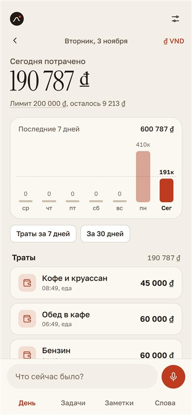
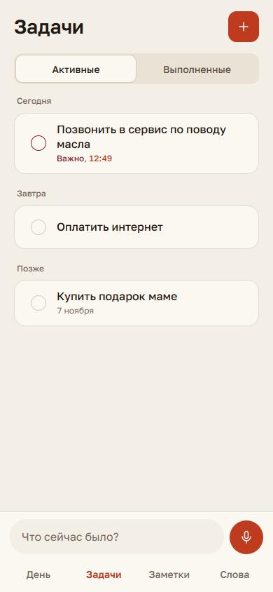
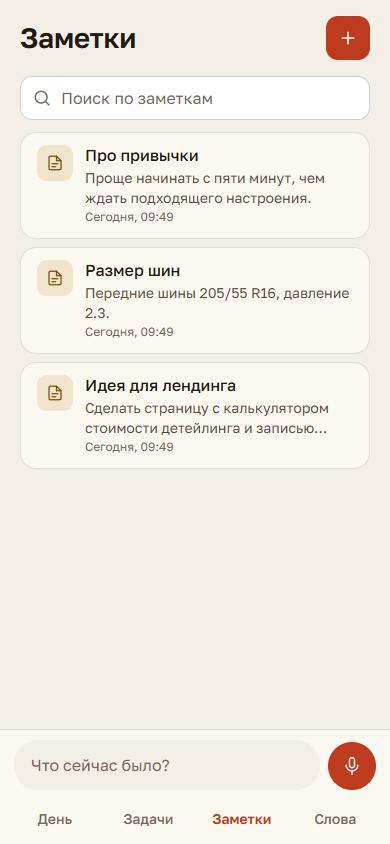
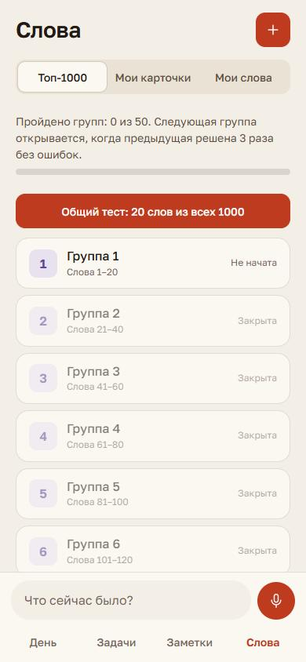

# TRACE

[Русская версия](README.ru.md)

TRACE is a voice-first personal assistant that lives in Telegram. You say a sentence ("coffee 85k, remind me to call the garage in three hours, note: front tyres are 205/55 R16") and TRACE splits it into actions: an expense, a task with a reminder, a note, a word for your dictionary. Everything is stored in your own database and shown in a Telegram Mini App.

It runs entirely on Cloudflare Workers and D1, so a single person can host it for free. The same code also supports many people with a Telegram Stars subscription.



| Tasks | Notes | Words |
| --- | --- | --- |
|  |  |  |

The interface and the bot speak Russian only. The screenshots use demo data.

## How it works

```
iPhone Action Button / Telegram voice or text / Mini App field
        -> speech to text (Groq Whisper, Cloudflare Whisper as fallback)
        -> LLM splits the phrase into actions (Gemini, then Groq, then Workers AI, then plain rules)
        -> Cloudflare D1 (SQLite)
        -> Telegram Mini App + bot cards with edit / delete buttons
```

An LLM never decides dates or amounts. It only classifies the phrase; code parses the numbers and the dates, and a set of safety nets (`enforceExpenseShape`, `voiceTargetMatches`) corrects the usual model mistakes. If every model is down, a rule-based fallback still records the phrase.

## What it does

- **Money.** Voice expenses with categories, a daily limit, a spending chart for 7 and 30 days, past days ("yesterday"), several currencies with live exchange rates, debts, and monthly recurring payments.
- **Tasks.** Dates from natural speech, reminders in Telegram with "done" and "snooze" buttons.
- **Notes.** Full phrase kept with tags and search.
- **Words.** Your own cards with reminders, plus a Top-1000 English course in 50 groups of 20 words with 4-choice tests. A group unlocks the next one after three perfect runs.
- **Voice edits.** "Change the last expense to 90 thousand" or "delete that note" works on the right record and never touches someone else's.
- **Many users.** Free trial, then a 30-day subscription paid in Telegram Stars. Daily record limits, refunds, owner commands (`/users`, `/grant`, `/revoke`, `/usage`, `/journal`), terms of service and a "delete all my data" button.

## Security and privacy

- Every query is scoped to a user; a test fails the build if any SQL on a data table has no `user_id`.
- Personal tokens are stored as SHA-256 hashes and accepted only from a header.
- Telegram webhook secret, per-address and per-user rate limits, request size limits, a strict CSP.
- Phrases of other users are not written to logs. Audio is not stored.
- Payments are checked twice (pre-checkout and a payment record with a unique charge id), and days are granted at most once per payment.

## Stack

Cloudflare Workers, D1, Workers AI, Gemini, Groq, Telegram Bot API and Mini Apps. Plain JavaScript on the backend (one file, `src/worker.js`) and in the app (one file, `src/app.html`). No framework.

## Run it yourself

You need Node.js 22.5 or newer, a Cloudflare account, a Telegram bot from [@BotFather](https://t.me/BotFather), and free API keys for [Gemini](https://aistudio.google.com/) and [Groq](https://console.groq.com/).

```bash
npm install

# 1. Create the database and put its id into wrangler.jsonc
npx wrangler d1 create trace-db
npx wrangler d1 execute trace-db --remote --file=./schema.sql

# 2. Secrets
npx wrangler secret put AUTH_TOKEN
npx wrangler secret put TELEGRAM_BOT_TOKEN
npx wrangler secret put TELEGRAM_WEBHOOK_SECRET
npx wrangler secret put GEMINI_API_KEY
npx wrangler secret put GROQ_API_KEY

# 3. Deploy
npm run deploy
```

Then register the webhook as the owner: `POST /api/set-webhook` with the header `X-Setup-Key` set to your webhook secret, and set the Mini App URL (`/app`) in BotFather. In `wrangler.jsonc` change `database_id`, `SUPPORT_CONTACT` and remove `SHORTCUT_URL` (it points to the author's iPhone Shortcut).

For local work copy `.dev.vars.example` to `.dev.vars`, then:

```bash
npx wrangler d1 execute trace-db --local --file=./schema.sql
npm run dev
```

Open `http://localhost:8787/app?token=<AUTH_TOKEN>` at a phone width.

## Tests

```bash
npm test
```

157 tests run on `node:test` with `node:sqlite` in place of D1 and a mocked `fetch`. GitHub Actions runs them on every push.

## Status

Built and used daily by its author. The payment flow, limits and refunds are covered by tests; a payment with real Stars has not been run end to end yet.

## Credits and licence

Code: [MIT](LICENSE).

The Top-1000 word list is taken from the New General Service List 1.2 (Browne, Culligan, Phillips, [newgeneralservicelist.com](https://www.newgeneralservicelist.com/)), licensed CC BY-SA 4.0. Translations and pronunciations were written by hand and may contain mistakes. The word list files (`src/top_words*.js`) keep that licence.
