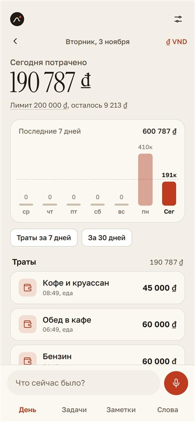
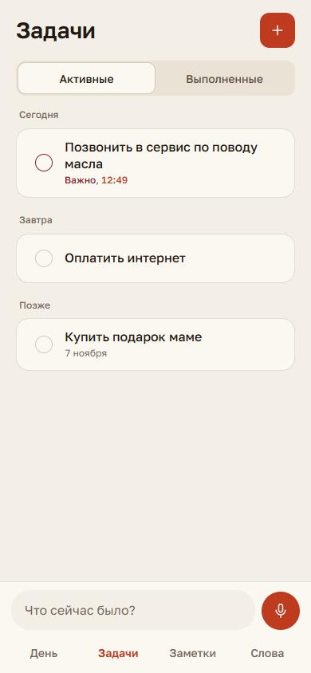
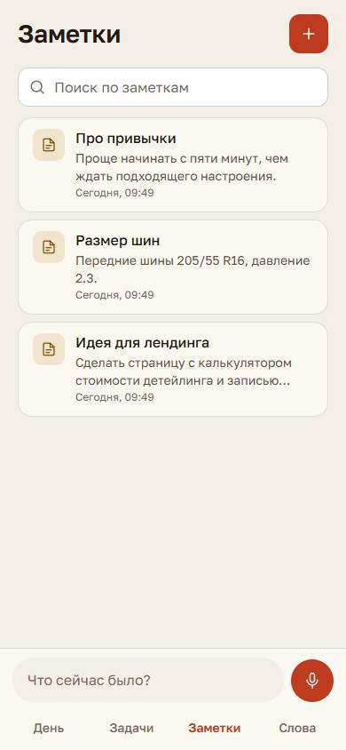
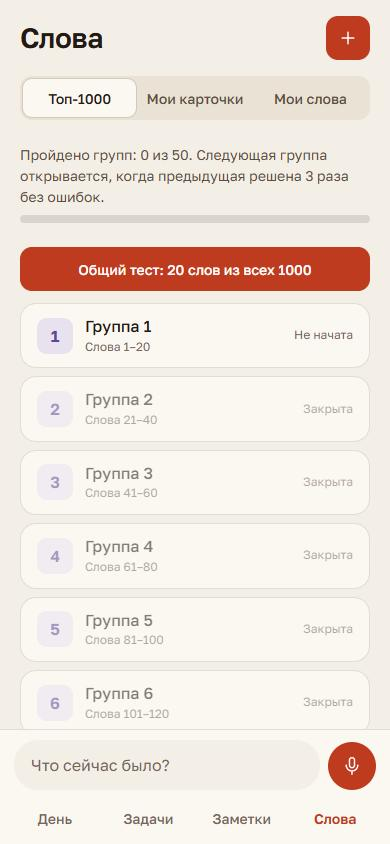

# TRACE

[English version](README.md)

TRACE это голосовой личный ассистент в Telegram. Вы говорите фразу («кофе 85 тысяч, напомни через три часа позвонить в сервис, заметка: передние шины 205/55 R16»), а TRACE раскладывает её на действия: трату, задачу с напоминанием, заметку, слово для словаря. Всё хранится в вашей базе и показывается в Mini App внутри Telegram.

Проект целиком работает на Cloudflare Workers и D1, поэтому один человек может держать его бесплатно. Тот же код умеет работать и для многих людей с подпиской за Telegram Stars.



| Задачи | Заметки | Слова |
| --- | --- | --- |
|  |  |  |

Интерфейс и бот только на русском. На скриншотах демо-данные.

## Как это устроено

```
Кнопка действия на iPhone / голос или текст в Telegram / поле в Mini App
        -> речь в текст (Groq Whisper, запасной Cloudflare Whisper)
        -> нейросеть раскладывает фразу на действия (Gemini, потом Groq, потом Workers AI, потом простые правила)
        -> Cloudflare D1 (SQLite)
        -> Mini App в Telegram + карточки бота с кнопками «изменить» и «удалить»
```

Даты и суммы нейросеть не решает. Она только определяет тип фразы, а числа и даты считает код. Страховки (`enforceExpenseShape`, `voiceTargetMatches`) исправляют типичные ошибки моделей. Если все модели недоступны, запись всё равно сохранится по простым правилам.

## Что умеет

- **Деньги.** Траты голосом по категориям, дневной лимит, график за 7 и 30 дней, прошлые дни («вчера»), несколько валют с живым курсом, долги и ежемесячные платежи.
- **Задачи.** Даты из обычной речи, напоминания в Telegram с кнопками «готово» и «отложить».
- **Заметки.** Фраза сохраняется целиком, есть теги и поиск.
- **Слова.** Свои карточки с напоминаниями и курс «Топ-1000» английских слов: 50 групп по 20 слов. К каждому слову дано короткое предложение с переводом, а тесты на 4 варианта чередуют вопросы «что значит слово здесь» и «вставьте пропущенное слово». Следующая группа открывается после трёх безошибочных прохождений.
- **Правки голосом.** «Поменяй последнюю трату на 90 тысяч» или «удали эту заметку» работает на нужной записи и не трогает чужую.
- **Много людей.** Пробный период, затем подписка на 30 дней за Telegram Stars. Дневные лимиты записей, возвраты, команды владельца (`/users`, `/grant`, `/revoke`, `/usage`, `/journal`), условия использования и кнопка «удалить все мои данные».

## Безопасность и приватность

- Каждый запрос ограничен своим пользователем. Если в SQL по таблице с данными нет `user_id`, тест роняет сборку.
- Личные токены хранятся как хэш SHA-256 и принимаются только из заголовка.
- Секрет вебхука Telegram, ограничение частоты запросов по адресу и по человеку, ограничение размера запросов, строгий CSP.
- Фразы других людей не попадают в логи. Аудио не сохраняется.
- Платёж проверяется дважды (pre-checkout и запись платежа с уникальным номером), дни за один платёж начисляются не больше одного раза.

## Технологии

Cloudflare Workers, D1, Workers AI, Gemini, Groq, Telegram Bot API и Mini Apps. Чистый JavaScript в бэкенде (один файл `src/worker.js`) и в приложении (один файл `src/app.html`). Без фреймворков.

## Запуск у себя

Нужны Node.js 22.5 или новее, аккаунт Cloudflare, бот в Telegram от [@BotFather](https://t.me/BotFather) и бесплатные ключи [Gemini](https://aistudio.google.com/) и [Groq](https://console.groq.com/).

```bash
npm install

# 1. Создать базу и вписать её id в wrangler.jsonc
npx wrangler d1 create trace-db
npx wrangler d1 execute trace-db --remote --file=./schema.sql

# 2. Секреты
npx wrangler secret put AUTH_TOKEN
npx wrangler secret put TELEGRAM_BOT_TOKEN
npx wrangler secret put TELEGRAM_WEBHOOK_SECRET
npx wrangler secret put GEMINI_API_KEY
npx wrangler secret put GROQ_API_KEY

# 3. Выложить
npm run deploy
```

После этого зарегистрируйте вебхук от имени владельца: `POST /api/set-webhook` с заголовком `X-Setup-Key`, равным вашему секрету вебхука, и укажите адрес Mini App (`/app`) в BotFather. В `wrangler.jsonc` поменяйте `database_id` и `SUPPORT_CONTACT`, а `SHORTCUT_URL` удалите (там ссылка на команду iPhone автора).

Для работы на своём компьютере скопируйте `.dev.vars.example` в `.dev.vars`, затем:

```bash
npx wrangler d1 execute trace-db --local --file=./schema.sql
npm run dev
```

Откройте `http://localhost:8787/app?token=<AUTH_TOKEN>` в ширине телефона.

## Тесты

```bash
npm test
```

157 тестов на `node:test`, вместо D1 стоит `node:sqlite`, `fetch` подменён. GitHub Actions запускает их при каждой отправке кода.

## Состояние

Проект собран и каждый день используется автором. Оплата, лимиты и возвраты покрыты тестами, но платёж настоящими Stars целиком пока не проверялся.

## Авторство и лицензия

Код: [MIT](LICENSE).

Список «Топ-1000» взят из New General Service List 1.2 (Browne, Culligan, Phillips, [newgeneralservicelist.com](https://www.newgeneralservicelist.com/)) по лицензии CC BY-SA 4.0. Переводы и произношение написаны вручную, возможны неточности. Файлы со словами (`src/top_words*.js`) сохраняют эту лицензию.
